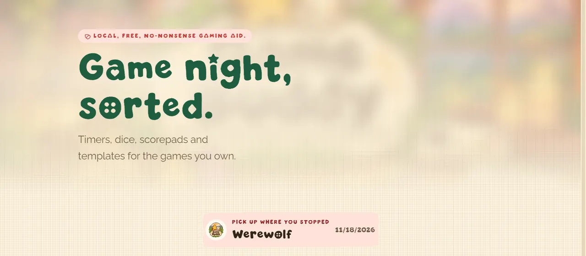
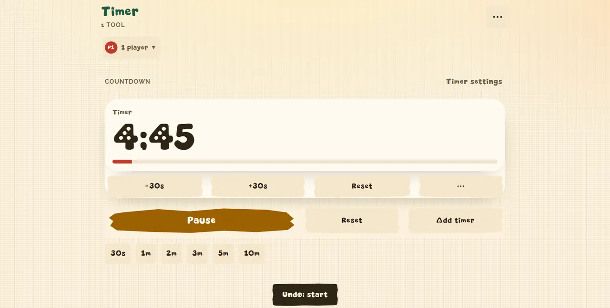
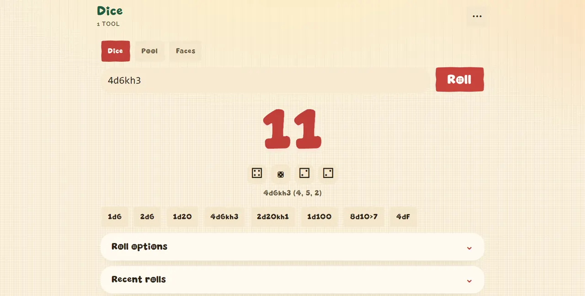
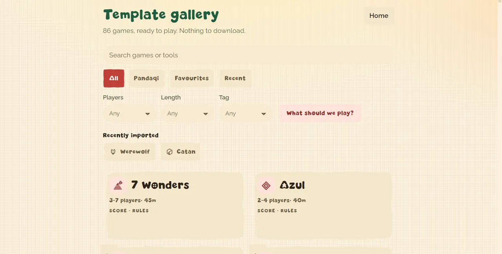
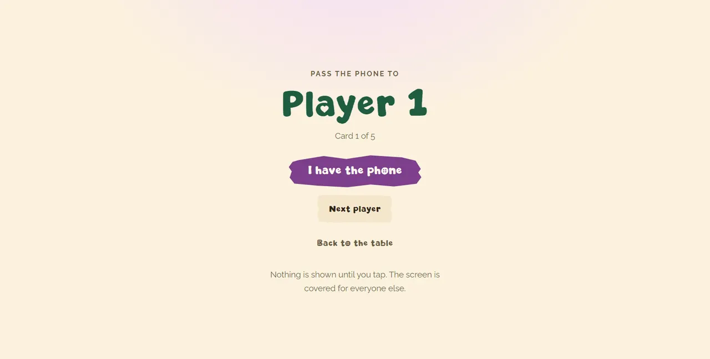

# Game Buddy

**Tools to make your board/video game night easier and more fun!** 

* Timers, dice, scorepads, secret roles, brackets, and more.
* Some 85+ ready-to-play templates for popular games already on your table. 
* Author your own templates, tools, or themes for your needs.
* One page, no account, offline or online. Just start using it and play anywhere :)

**[Use it now →](https://pandaqi.com/game-buddy/)** ·
[Download the offline file](https://pandaqi.com/game-buddy/pq-game-buddy.html) ·
[Documentation](#documentation)

[](https://github.com/Pandaqi/pq-game-buddy/actions/workflows/release.yml)
[](package.json)
[](https://svelte.dev)
[](tsconfig.json)
[](https://bun.sh)

[](#tools)
[](#templates)
[](#languages)
[](tests)
[](LICENSE)
[](package.json)
[](#what-it-does-not-do)



## Two ways to use it

| You want to | Do this |
|-------------|---------|
| Play tonight | Open [pandaqi.com/game-buddy](https://pandaqi.com/game-buddy/). Nothing to install. |
| Play without internet | Download [pq-game-buddy.html](https://pandaqi.com/game-buddy/pq-game-buddy.html) and double-click it. The whole app is in that one file, fonts and all. |
| Keep it on a phone | Open the hosted site once and use "Install" (it is a PWA). Or save the single file. |
| Add a game of your own | Write a plain-text `.gamebuddy` template: [docs/TEMPLATE-FORMAT.md](docs/TEMPLATE-FORMAT.md). |
| Add a tool | One folder: [docs/TOOL-AUTHORING.md](docs/TOOL-AUTHORING.md). |
| Share a tool as a file | A `.gamebuddy-tool`: [docs/PLUGIN-FORMAT.md](docs/PLUGIN-FORMAT.md). |
| Restyle it | A `.gamebuddy-theme` token file: [docs/THEME-FORMAT.md](docs/THEME-FORMAT.md). |
| Run and build the code | See [below](#run-and-build). |

## Run and build

```bash
bun install
bun run dev          # dev server with HMR, prints its URL
bun run check        # the gate: stale manifest, tsc, svelte-check, tests, template lint, build
```

| Command | What you get |
|---------|--------------|
| `bun run build` | `dist/`: the hosted app (`index.html`, `app.js`, `app.css`, lazy chunks, fonts) plus `dist/pq-game-buddy.html`, one self-contained offline file |
| `bun run build:site` | The same, plus a real page per tool (`dist/<tool>/`) and per template (`dist/template/<id>/`), for search engines and links |
| `bun run build:single` | Only `dist/index.html`, with JS, CSS and fonts embedded: one file to copy around |
| `bun run build --langs=nl` | A build that carries one language instead of all fourteen |
| `bun run size` | Checks `dist/size.json` against the byte budgets; `build` already fails over them |
| `bun run gen` | Regenerates the manifest, schemas and template index after adding a tool or template |

`bun run check` must pass before a change lands. It is also what
[the release workflow](.github/workflows/release.yml) runs on every push and pull
request, before it considers cutting a release.

Every change also bumps `version` in `package.json` (semantic versioning) and runs
`bun run gen`: on `main`, the same workflow tags `v<version>` and publishes the single
file, the hosted build and the site build when that number is new. See
[docs/RELEASING.md](docs/RELEASING.md) §2.

## Tools

Twenty built-in tools for the most common use cases.

| Tool | What it is for |
|------|----------------|
| **Timer** | Countdown, stopwatch, flip timer, chess clock, intervals, phase sequences, several clocks at once |
| **Dice** | Any notation (`4d6kh3`, `2d20`, `d%`), pools, exploding and success dice, saved macros, custom word faces |
| **Coin** | Fair or weighted flips, call it, best-of series |
| **Pick** | Random numbers, lists, teams or seats, shown as a list, card, wheel or slot |
| **Score** | Totals, rounds, categories with formulas, or a money ledger; per-cell notes, targets, CSV |
| **Lives** | HP, lives, stocks; tap a score to type a whole hit; extra tracks; conditions; elimination |
| **Counters** | Wood, coins, tokens, a shared bank with transfers, or a straight points counter |
| **Turns** | Whose turn, which round, which phase, optional turn clock, pass-the-phone cover |
| **Reveal** | Secret roles with hold-to-reveal, anonymous ballots, blind bids |
| **Rules** | The quick card, setup checklist, glossary, scoring reference and source link |
| **Decks** | Standard, Euchre, Skat, Rummy, UNO, tarot, domino or your own; shuffle, cut, deal, hidden hands |
| **Bag** | Blind draws from tiles or tokens, letter values, per-player trays |
| **Bracket** | Single and double elimination, round robin, groups, Swiss, with tiebreaks |
| **Draft** | Linear and snake order, pick clock, auction with budgets |
| **Buzzer** | Who tapped first, false starts, reaction times, keyboard lanes |
| **Script** | Narrate a round: say, wait, reveal, start a timer, optional spoken voice |
| **Words** | Is this a word? Filters, anagrams, rack solver with blanks, Codenames board |
| **Prompts** | Party and designer prompt packs, custom packs |
| **Custom** | Build a tracker from fields, counters, a checklist, a table and safe formulas |
| **Splits** | Speedrun splits with targets, personal bests and gold splits |

Besides tools,

* **Play log** is a page rather than a tool: search, filters, win rates, time played and CSV/JSON export. 
* **Display mode** (`#/display/<tool>`) puts a huge read-only readout on a second screen or a projector. 
* **Print** styles cover score sheets, brackets, rules and summaries.

 



## Templates

Eighty-six bundled games. Each with its own settings, a rules card in our own words and a
drawn mark. Pick one, choose the player count, play.

| Family | Examples |
|--------|----------|
| Board and strategy | Catan, Ticket to Ride, 7 Wonders, Wingspan, Azul, Splendor, Dominion, Terraforming Mars, Spirit Island |
| Card and deduction | Uno, Coup, Love Letter, The Mind, Hanabi, Skull, Decrypto, Dixit, poker, chess |
| Dice and push your luck | Yahtzee, Phase 10, Perudo, Farkle, Darts |
| Word | Scrabble, Boggle, Bananagrams, Codenames, Just One, Scattergories |
| Party and social deduction | Werewolf, Secret Hitler, Avalon, Wavelength, Charades, Monikers, Spyfall, Taboo |
| Video game and tournament | Mario Kart night, Smash night, Jackbox night, speedrun practice |
| RPG and co-op | D&D 5e, Gloomhaven, Betrayal at House on the Hill |
| Pandaqi | Twenty templates for [Pandaqi's own games](https://pandaqi.com/): Bidding Blocks, Naivigation, Chiptales, Maybe Games, … |

The [full gallery](https://pandaqi.com/game-buddy/#/templates) filters by players, length
and tag. 

* Every template is a real URL (`/game-buddy/template/catan/`)
* The catalogue is published at [`templates.json`](https://pandaqi.com/game-buddy/templates.json).
* (So that another site can check its links against it.)



## Languages

Fourteen complete languages: English, Nederlands, Deutsch, Español, Français, Português,
Italiano, Bahasa Indonesia, Türkçe, Tiếng Việt, Polski, 日本語, 简体中文 and 한국어. 

* Every shell string and every tool string is translated. 
* A test fails the build when a language misses one.
* Each language is a lazy chunk, so the app only downloads the one you pick.
* Filtered builds can carry a single language: `bun run build --langs=nl`. 
* (The Words tool ships a curated word list per language too.)

## What it does NOT do

- **No network requests.** No fonts, images, analytics, CDN, "check for updates", whatever.
- **No account, no cloud, no tracking.** Templates and play history live on the device and
  leave only when you export them.
- **No virtual tabletop.** The physical game (or video game) stays the source of truth; this is a large **helper** around it.



## Documentation

| Read | For |
|------|-----|
| [docs/USER-GUIDE.md](docs/USER-GUIDE.md) | Using the app as a player or host |
| [docs/TEMPLATE-FORMAT.md](docs/TEMPLATE-FORMAT.md) | The `.gamebuddy` format, version 1 |
| [docs/PLUGIN-FORMAT.md](docs/PLUGIN-FORMAT.md) | A tool as a file (`.gamebuddy-tool`) |
| [docs/THEME-FORMAT.md](docs/THEME-FORMAT.md) | Restyling with a `.gamebuddy-theme` |
| [docs/TOOL-AUTHORING.md](docs/TOOL-AUTHORING.md) | Adding a tool to the repo |
| [docs/ARCHITECTURE.md](docs/ARCHITECTURE.md) | Invariants, layers, storage, build |
| [docs/STYLE.md](docs/STYLE.md) | Tokens, type, marks, motion |
| [docs/ACCESSIBILITY.md](docs/ACCESSIBILITY.md) | What the app promises and how to check it |
| [LICENSE](LICENSE) | The MIT licence the code ships under |
| [docs/LICENSES.md](docs/LICENSES.md) | Fonts, marks, word lists, templates, attribution |
| [docs/COMMUNITY.md](docs/COMMUNITY.md) | Contributing a template |
| [ROADMAP.md](ROADMAP.md) | What is built, what is next, what needs a human |
| [CHANGELOG.md](CHANGELOG.md) | What changed, in order |
| [AGENTS.md](AGENTS.md) | The working rules for this repository |

## Contributing

**Templates, bug reports, and translations are welcome:** open an issue or a pull request.

* New _Tools_ are always nice too, but the current tool set is already quite large and I don't see any other tool that must become core/bundled.
* Run `bun run check` first; it is the same gate CI runs. 
* A template submission needs its own prose and a source link — see [docs/COMMUNITY.md](docs/COMMUNITY.md).
* Large parts of the core framework were made using (free) AI coding assistants. I simply wanted these tools to exist, for free, and this was the fastest way. 
  * I am (currently) neither for nor against AI usage in coding. 
  * This framework grew out of 4 tools I had created manually years ago (hosted at pandaqi.com/tools then) and is now a wonderfully weird mixture of manual coding and AI assistance.

## Licence and attribution

The code is **MIT licensed**: use it, change it, ship it, keep the copyright notice. See
[LICENSE](LICENSE). [docs/LICENSES.md](docs/LICENSES.md) records the rest:

- Templates are fan-made helpers under **CC BY-SA 4.0**, with original rules summaries and
  a source link on every file. Game names are used descriptively; this project is not
  affiliated with or endorsed by any publisher.
- The two bundled typefaces (Raleway, SIL OFL 1.1, and Game Buddy, derived from DejaVu /
  Bitstream Vera) ship with their notices.
- Word lists and prompt packs are hand-curated for this project under CC BY-SA 4.0. They
  are starter lists, not tournament dictionaries.

Made by [Tiamo](https://pandaqi.com/) · [pandaqi.com/game-buddy](https://pandaqi.com/game-buddy/)
